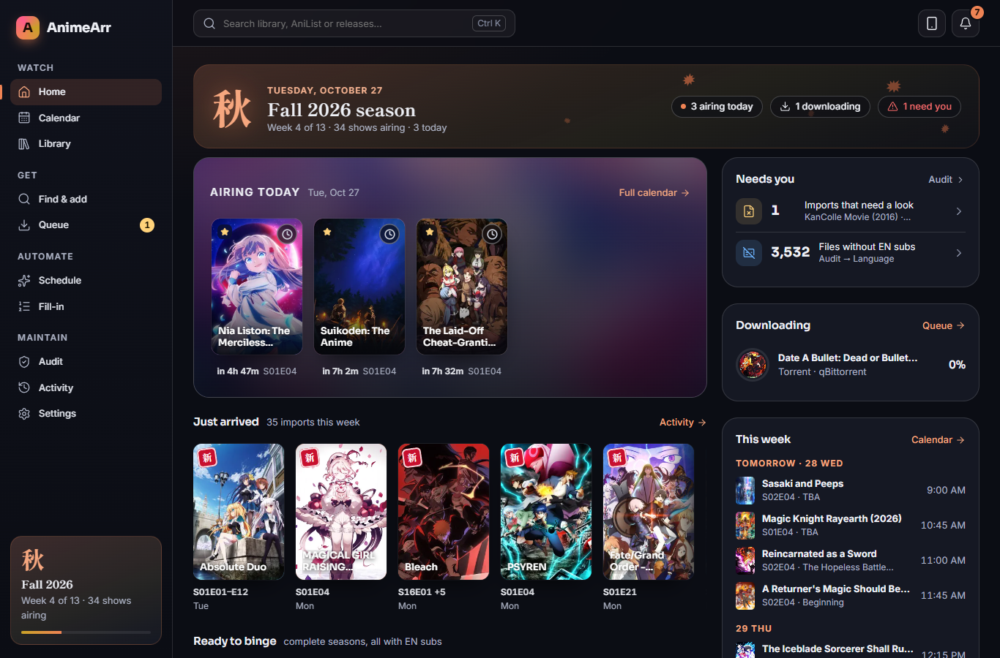
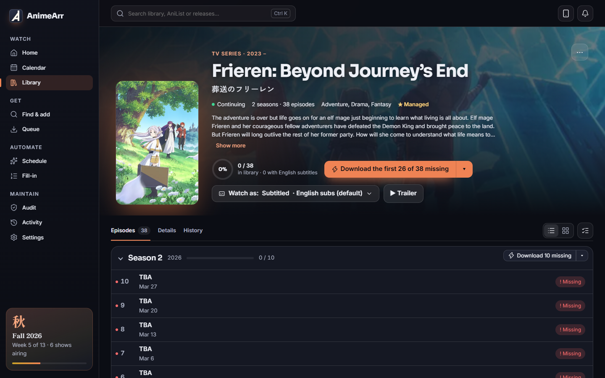
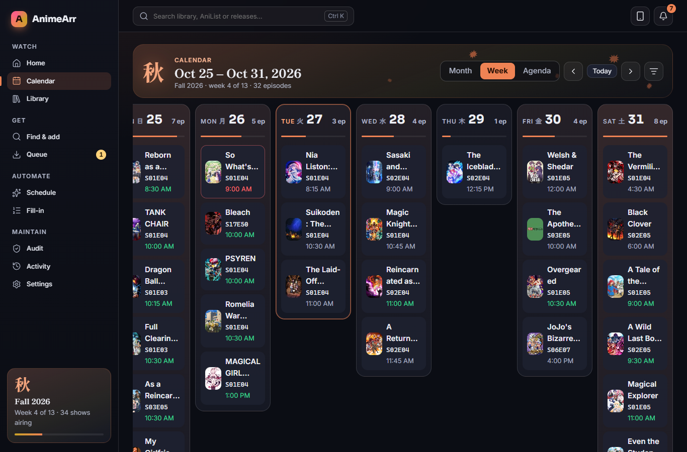

# AnimeArr

<p>
  <a href="https://ko-fi.com/moritranslates"></a>
</p>

> **Beta (v0.9.0-beta).** It runs a real library every day, but it's young: expect rough edges, and keep backups. It
> starts in **dry run** (it shows what it would grab without downloading anything) until you switch that off.

**An anime-first library manager.** AnimeArr finds, checks and imports anime the way anime is actually released:
fansub numbering, absolute episodes, BD batches, specials, creditless openings, dual audio and, above all, **subtitles
in your language**. It works next to Sonarr, Radarr and Prowlarr, and can take over your anime from them when you're
ready. Phone-friendly, seasonal, and a little bit extra.



<p>
  
  
</p>

## What it does

- **Knows anime numbering.** AniList + AniDB + Anime-Lists mapping: "S6 - 01", absolute episodes, split cours, season
  packs called "Season 1" or "(01-12)", per-show aliases and rules. No TheXEM needed.
- **Checks before it imports.** Every download is probed with ffprobe: full subtitles in your language (not just signs),
  the right audio for your profile (Sub, Dub, Dual or Either), not a sample. A release that fails is blocklisted and the
  next one is tried; one that passes is imported and renamed.
- **Explains every choice.** Search results, grabs and skips come with a plain-language "why", and every action is in
  Activity with an undo where possible.
- **Fixes what's already there.** Audit your library for files without your subtitle language, gaps and specials;
  "Fix detection" for wrongly tagged tracks; **Replace season** swaps a bad season for a good pack, episode by episode,
  only after each new file passes its check (the old ones go to a recycling bin).
- **Plays nicely with your stack.** Prowlarr or direct indexers (Newznab, Torznab, Nyaa, SubsPlease, RSS), with a
  circuit breaker for broken ones; SABnzbd, NZBGet, qBittorrent, Transmission, Deluge, rTorrent (see the
  [download client support](#download-clients) table); Plex scans and "Watch in Plex"; Discord and ntfy notifications;
  a migration path from Sonarr/Radarr.
- **Smart batch grabs.** A 26-episode batch when you're missing 4: torrent clients that can skip files download only
  those 4 (plus their subtitles and fonts); per season it decides between "only the missing episodes" and "replace the
  whole season with one group" (same quality or better), and says why in plain words.
- **Looks after itself.** Stalled-download handling, clean-up after imports, a recycling bin with retention, nightly
  backups, a seasonal calendar with airing countdowns, an installable phone app (scan the QR code in Settings).

What it doesn't do yet is listed in [PARITY.md](PARITY.md) (honestly) and [BACKLOG.md](BACKLOG.md).

## Download clients

| Client | Protocol | Add / status / progress | Category or label | Seeding & ratio | Remove (with data) | Partial batch downloads | Test | Wizard / Sonarr import |
|---|---|---|---|---|---|---|---|---|
| SABnzbd | Usenet | ✅ | category | n/a | ✅ (AnimeArr deletes the folder SABnzbd leaves behind) | — (whole batch; leftovers cleaned after import) | ✅ | ✅ / ✅ |
| NZBGet | Usenet | ✅ | category | n/a | ✅ | — (whole batch) | ✅ | ✅ / ✅ |
| qBittorrent | Torrent | ✅ | category | ✅ ratio + time | ✅ | ✅ | ✅ | ✅ / ✅ |
| Transmission | Torrent | ✅ | label + sub-folder | ratio only | ✅ | ✅ | ✅ | ✅ / ✅ |
| Deluge (2.x; 1.3 best effort) | Torrent | ✅ | Label plugin (optional) + sub-folder | ratio only | ✅ | ✅ | ✅ | ✅ / ✅ |
| rTorrent / ruTorrent | Torrent | ✅ | d.custom1 label + sub-folder | ratio shown, no limit set | ✅ (AnimeArr deletes the data inside its download folders) | ✅ | ✅ | ✅ / ✅ |
| Usenet Blackhole¹ | Usenet | drop .nzb / watch folder, no progress | — | n/a | watch file only; finished folder cleaned after import | — (whole batch) | folders checked | — / — |
| Torrent Blackhole¹ | Torrent | drop .torrent (.magnet optional) / watch folder, no progress | — | — | watch file only; never touches your files | — (whole batch) | folders checked | — / — |

Clients without partial downloads (and all Usenet clients) download the whole batch; the import takes only the wanted
files and the rest is cleaned up after a confirmed import. The download-folder clean-up and seeding rules (Settings →
Downloads) read qBittorrent and SABnzbd only for now.

¹ Blackhole is off by default, never offered by the setup wizard, and never picked while a real client of the same
protocol is on unless its priority is better. It starts disabled until its folders pass Test (the completed folder
must be one of the importer's source roots). What you lose with Blackhole:
- no download progress, speed, ETA or seeders in the Queue (only "Waiting for download…");
- no partial batch downloads: whole batches are downloaded (only the wanted files are imported);
- stall and queue-health checks don't apply; only the timeout does (24 h by default), then the next release is tried;
- AnimeArr can't pause or remove the download in your downloader, or see seeding and ratio; it never cleans up a
  torrent's files (torrents are copied or hardlinked, never moved);
- slower to notice finished downloads: a download counts as done when its size stays the same for about a minute;
- downloads are matched by release name: one your downloader renames isn't found and needs a manual import;
- Usenet: failed downloads and repair errors in your downloader aren't seen; AnimeArr only notices that nothing arrived;
- Torrent: magnet-only releases are skipped unless "Save magnet links as .magnet files" is on.

## Quick start (Docker)

```yaml
services:
  animearr:
    image: ghcr.io/moritranslates/animearr:beta
    container_name: animearr
    restart: unless-stopped
    environment:
      - PUID=1000
      - PGID=1000
      - TZ=Etc/UTC
    volumes:
      - ./animearr/config:/config   # local disk, not a network share
      - /path/to/data:/data         # downloads + media, same paths as Sonarr/Radarr
    ports:
      - 8484:8484
```

Then open `http://<server>:8484`, create your account, and follow the setup wizard ("I'm new" or "I already use
Sonarr/Radarr"). The full example is [docker-compose.yml](docker-compose.yml).

**The paths matter.** AnimeArr checks and imports files itself, so it needs to see the downloads and the library at the
same paths your download clients (and Sonarr/Radarr) use. One `/data` folder holding both downloads and media
([TRaSH-guides style](https://trash-guides.info/File-and-Folder-Structure/)) lets imports be instant hardlinks.

**First start.** There is no default password. Create the account in the browser from your home network; if you're
not on the same network, the log prints a one-time setup code.

### Platform notes

| | |
|---|---|
| **Unraid** | Use the template in [docker/unraid/animearr.xml](docker/unraid/animearr.xml) (PUID 99, PGID 100). Put `/config` on a cache-only appdata share. |
| **Synology** (Container Manager) | Create a project from the compose file. PUID is usually `1026`, PGID `100` (check with `id` over SSH). |
| **TrueNAS SCALE** | Custom app or compose; the apps user is `568:568`. |
| **Plain Docker / Linux** | The compose file as is; `id` shows your PUID/PGID. |
| **Windows** | Docker Desktop for now; a native installer comes after the beta. |
| **Raspberry Pi / ARM** | The image is multi-arch (amd64 + arm64). |

Environment: `PUID`, `PGID`, `UMASK` (default 002), `TZ`, `URL_BASE` (reverse proxy on a sub-path, e.g. `/animearr`),
`TRUST_PROXY` (your proxy's IP/CIDR, so real client IPs are seen), `ANIMEARR_LOCAL_NETWORKS` (what counts as "home" for
the optional no-password-at-home setting).

Keep `/config` on a local disk: SQLite databases can be damaged on SMB/NFS shares.

## Known limitations in the beta

- No quality profiles/cutoffs, custom formats or must/must-not-contain words yet: choices come from your language
  profile, size preset and resolution.
- No Sonarr-compatible API, so Overseerr/Jellyseerr, Bazarr, LunaSea or nzb360 can't talk to AnimeArr directly.
- Jellyfin/Emby/Kodi aren't supported yet (Plex is). Notifications are Discord and ntfy.
- An existing anime folder can't yet be imported without Sonarr (new users add shows one by one).
- RAR archives aren't unpacked (7z/ZIP are). No blocklist page, log viewer or downloadable backups yet.

## How this was built

AnimeArr was built with [Claude Code](https://claude.com/claude-code), directed and tested every day by an anime nerd
with opinions about yellow subtitles. The AI wrote most of the code; the human decided
what it should do, broke it on purpose, and said "make it pop" more often than strictly necessary.

The commit history is written in the voice of the overworked ship's crew. It's honest underneath: every commit message
keeps the real technical description, and the project runs on boring safety rails:

- ~280 automated tests (parser, numbering, ranking, the grab → download → verify → import pipeline, clean-up, auth);
- independent code, security, accessibility and UX review rounds before the release;
- a dry-run mode, confirmations for anything that deletes, an undo log, and a recycling bin;
- a pre-commit scan for secrets and personal data.

If you find something the robots and the human both missed, please open an issue.

## Development

```bash
npm install
npm run dev        # builds the web UI, then runs the server on http://localhost:8484 (config in ./.devconfig)
npm test
```

See [CONTRIBUTING.md](CONTRIBUTING.md).

## Reporting bugs and security issues

Bugs and ideas: GitHub issues (the templates ask for what helps). Security: see [SECURITY.md](SECURITY.md) and please
don't open a public issue.

## Licence

GPL-3.0. See [LICENSE](LICENSE) and [NOTICE](NOTICE). Parts are ported from Sonarr (GPL-3.0); thank you to the
Sonarr/Radarr/Prowlarr developers, whose work this stands on.

## Support

AnimeArr is free and open source. If it's useful to you, you can buy the crew a coffee on
[Ko-fi](https://ko-fi.com/moritranslates).
