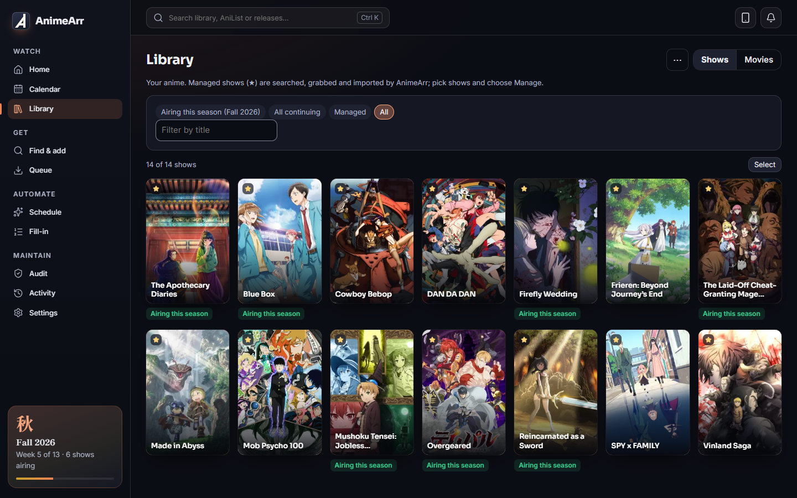
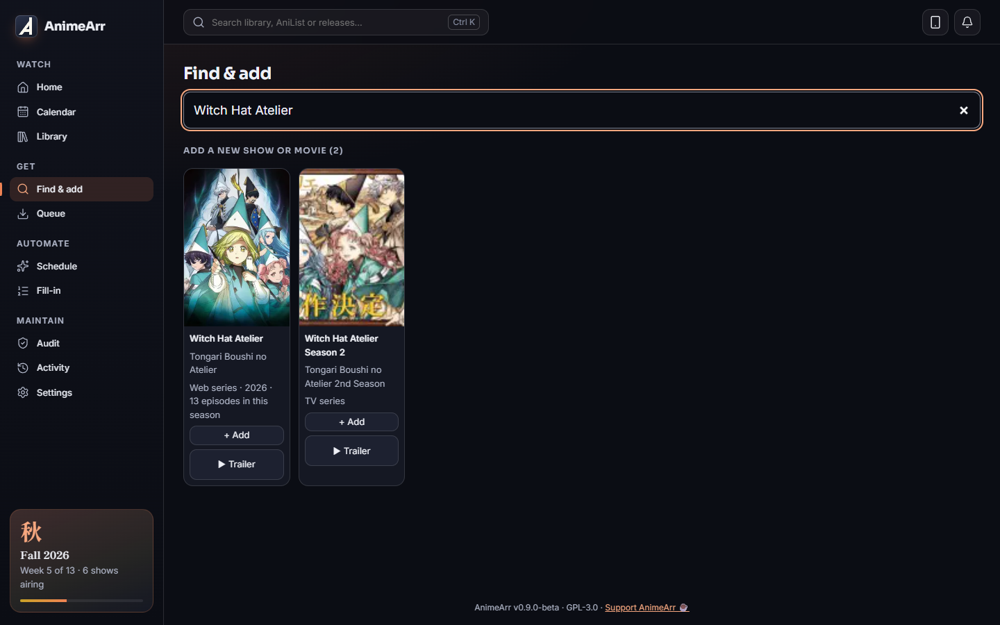
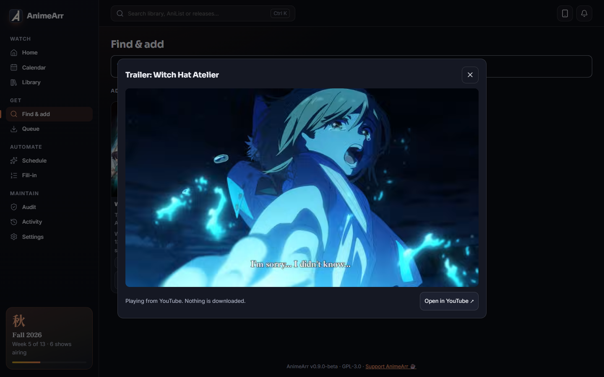
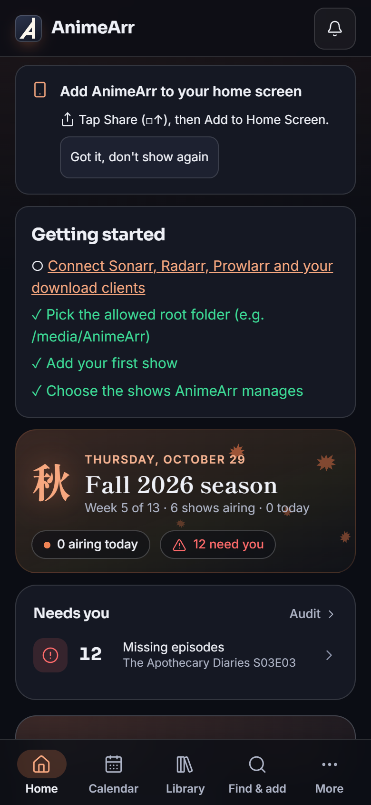

<p align="center">
  <picture>
    <source media="(prefers-color-scheme: dark)" srcset="docs/brand/animearr-wordmark-on-dark.svg" />
    
  </picture>
</p>

<p align="center">
  <b>The anime-first *arr.</b> Finds, checks and imports anime the way anime is actually released,<br />
  and makes sure every file has full subtitles in your language before it reaches your library.
</p>

<p align="center">
  <a href="LICENSE"></a>
  <a href="CHANGELOG.md"></a>
  <a href="https://github.com/MoriTranslates/animearr/pkgs/container/animearr"></a>
  
  <a href="https://ko-fi.com/moritranslates"></a>
</p>

<p align="center">
  <a href="#quick-start">Quick start</a> ·
  <a href="#why-animearr">Why AnimeArr</a> ·
  <a href="#screenshots">Screenshots</a> ·
  <a href="#faq">FAQ</a> ·
  <a href="#known-limitations-in-this-beta">Known limitations</a> ·
  <a href="#docs">Docs</a>
</p>

> [!NOTE]
> **Public beta (v0.9.0-beta).** It runs a real library every day, but it's young: expect rough edges and keep
> backups. It starts in **practice mode** (dry run: it shows what it would download, and downloads nothing) until you
> switch that off.



## Why AnimeArr

Sonarr is great at TV. Anime keeps breaking its assumptions: fansub numbering like "S6 - 01", absolute episodes,
split cours, season packs called "(01-12)", specials, creditless openings, dual audio, and releases that turn out to
have no English subtitles at all (or only signs). AnimeArr is built around those cases. It works **next to** Sonarr,
Radarr and Prowlarr, and can take your anime over from them when you're ready.

### Finds the right release
- **Knows anime numbering.** AniList + AniDB + Anime-Lists mapping: "S6 - 01", absolute episodes, split cours, season
  packs, per-show aliases and rules. No TheXEM needed.
- **Ranks by what you watch.** Language profiles with Sub, Dub, Dual or Either; size presets; group consistency within
  a season; burned-in and signs-only subtitles spotted.
- **Smart batch grabs.** Missing 4 episodes of a 26-episode batch? Torrent clients that can skip files download only
  those 4. Per season it decides between "just the missing ones" and "replace the whole season with one group".
- **Explains itself.** Every result, grab and skip comes with a plain-language "why".
- **▶ Trailer** <sup>new</sup>. Peek at a show's art style before adding it: the official trailer from AniList plays in
  Find & add, the Add dialog and the show page, with an "Open in YouTube" link. Nothing is ever downloaded.

### Checks before it imports
- **Every download is probed with ffprobe**: full subtitles in your language (not just signs), the right audio for your
  profile, not a sample. A release that fails is blocklisted and the next one is tried.
- **Catches wrong files** <sup>new</sup>. A series batch posing as a movie, a release that fits a different movie better,
  a dub without the original audio, subtitles in another language: refused before they replace anything. The
  after-import check also looks at files Sonarr imports (report-only by default).
- **Dual-audio upgrades** <sup>new</sup>. For shows you watch in Dual mode, sub-only episodes are upgraded when a proper
  dual-audio release turns up (report-only by default; the import checks that both audio tracks are really there).

### Fixes what's already there
- **Replace season** <sup>new</sup>. Swap a messy season for one good pack. It opens on a **Season packs** tab (whole
  season first, then upgrades over what you have), with **Single episodes** on their own tab, and labels each pack
  against your current files: TV < WEB-DL < Blu-ray < remux, then resolution. Each new episode is checked before its
  old file goes to the recycling bin.
- **Audit and Fix detection.** Files without your subtitle language, gaps, specials, wrongly tagged tracks.
- **Activity with undo.** Every action is logged in plain words, with an undo where possible.

### Lives on your server (and your phone)
- **Seasonal Home and calendar** with airing countdowns, Just arrived and Ready to binge.
- **Phone app** <sup>new</sup>. Install it from the "Add to home screen" card on your phone (or the QR code in Settings);
  it opens full screen, with the new mast-and-pennant icon.
- **Plays nicely with your stack.** Prowlarr or direct indexers (Newznab, Torznab, Nyaa, SubsPlease, RSS) with a circuit
  breaker for broken ones; SABnzbd, NZBGet, qBittorrent, Transmission, Deluge, rTorrent (see
  [download clients](#download-clients)); Plex, Jellyfin, Emby and Kodi (see [media servers](#media-servers)); Discord and ntfy; a guided migration from
  Sonarr/Radarr.
- **Looks after itself.** Stalled-download handling, clean-up after imports, a recycling bin with retention, nightly
  backups.

## Screenshots

<table>
  <tr>
    <td width="50%"><br /><sub>A show page: progress, watch mode and ▶ Trailer.</sub></td>
    <td width="50%"><br /><sub>Find & add: AniList search with Add and ▶ Trailer.</sub></td>
  </tr>
  <tr>
    <td width="50%"><br /><sub>The trailer plays in place. Nothing is downloaded.</sub></td>
    <td width="50%"><br /><sub>The seasonal calendar.</sub></td>
  </tr>
</table>

<p align="center">
  <br />
  <sub>On a phone: the "Add to home screen" card.</sub>
</p>

## Quick start

### Docker Compose

```yaml
services:
  animearr:
    image: ghcr.io/moritranslates/animearr:beta
    container_name: animearr
    restart: unless-stopped
    environment:
      - PUID=1000
      - PGID=1000
      - TZ=Etc/UTC
    volumes:
      - ./animearr/config:/config   # local disk, not a network share
      - /path/to/data:/data         # downloads + media, same paths as Sonarr/Radarr
    ports:
      - 8484:8484
```

The commented version is [docker-compose.yml](docker-compose.yml).

### Docker run

```bash
docker run -d --name animearr -p 8484:8484 \
  -e PUID=1000 -e PGID=1000 -e TZ=Etc/UTC \
  -v /path/to/appdata/animearr:/config -v /path/to/data:/data \
  ghcr.io/moritranslates/animearr:beta
```

### Unraid

Use the template in [docker/unraid/animearr.xml](docker/unraid/animearr.xml) (PUID 99, PGID 100) and put `/config` on
a cache-only appdata share.

Then open `http://<server>:8484`, log in, and follow the setup wizard ("I'm new" or "I already use Sonarr/Radarr").

> [!IMPORTANT]
> **First login: captain / morebooty.** Every new install starts with this known default login. It works **only on your
> home network until you change it**: logins with the default password from anywhere else (the internet, a reverse
> proxy, a tunnel) are refused. The wizard's first step offers to change it ("Later" is fine), and a banner reminds you
> until you do (Settings → Security). Installs that already have an account keep it.
>
> "Home network" is judged by the address a connection comes from (10.x, 192.168.x, private IPv6 including Tailscale,
> so shared Tailscale nodes count too). Internet traffic that reaches AnimeArr *from* a LAN address looks local: a
> router port-forward with NAT/masquerade, or a plain TCP forwarder (nginx `stream`, HAProxy tcp mode, frp, `ssh -R`,
> socat). So **change the password on first run**, don't port-forward AnimeArr directly, and expose it only through an
> HTTP reverse proxy (which adds `X-Forwarded-For`) or a VPN. Details in [SECURITY.md](SECURITY.md).

**The paths matter.** AnimeArr checks and imports files itself, so it needs to see the downloads and the library at the
same paths your download clients (and Sonarr/Radarr) use. One `/data` folder holding both downloads and media
([TRaSH-guides style](https://trash-guides.info/File-and-Folder-Structure/)) lets imports be instant hardlinks. Keep
`/config` on a local disk: SQLite databases can be damaged on SMB/NFS shares.

<details>
<summary><b>Platform notes and environment variables</b></summary>

| | |
|---|---|
| **Unraid** | Template in [docker/unraid/animearr.xml](docker/unraid/animearr.xml) (PUID 99, PGID 100). `/config` on a cache-only appdata share. |
| **Synology** (Container Manager) | Create a project from the compose file. PUID is usually `1026`, PGID `100` (check with `id` over SSH). |
| **TrueNAS SCALE** | Custom app or compose; the apps user is `568:568`. |
| **Plain Docker / Linux** | The compose file as is; `id` shows your PUID/PGID. |
| **Windows** | Docker Desktop for now; a native installer comes after the beta. |
| **Raspberry Pi / ARM** | The image is multi-arch (amd64 + arm64). |

Environment: `PUID`, `PGID`, `UMASK` (default 002), `TZ`, `URL_BASE` (reverse proxy on a sub-path, e.g. `/animearr`),
`TRUST_PROXY` (your proxy's IP/CIDR, so real client IPs are seen), `ANIMEARR_LOCAL_NETWORKS` (what counts as "home"
for the default login and the optional no-password-at-home setting).

</details>

## Download clients

| Client | Protocol | Add / status / progress | Category or label | Seeding & ratio | Remove (with data) | Partial batch downloads | Test | Wizard / Sonarr import |
|---|---|---|---|---|---|---|---|---|
| SABnzbd | Usenet | ✅ | category | n/a | ✅ (AnimeArr deletes the folder SABnzbd leaves behind) | — (whole batch; leftovers cleaned after import) | ✅ | ✅ / ✅ |
| NZBGet | Usenet | ✅ | category | n/a | ✅ | — (whole batch) | ✅ | ✅ / ✅ |
| qBittorrent | Torrent | ✅ | category | ✅ ratio + time | ✅ | ✅ | ✅ | ✅ / ✅ |
| Transmission | Torrent | ✅ | label + sub-folder | ratio only | ✅ | ✅ | ✅ | ✅ / ✅ |
| Deluge (2.x; 1.3 best effort) | Torrent | ✅ | Label plugin (optional) + sub-folder | ratio only | ✅ | ✅ | ✅ | ✅ / ✅ |
| rTorrent / ruTorrent | Torrent | ✅ | d.custom1 label + sub-folder | ratio shown, no limit set | ✅ (AnimeArr deletes the data inside its download folders) | ✅ | ✅ | ✅ / ✅ |
| Usenet Blackhole¹ | Usenet | drop .nzb / watch folder, no progress | — | n/a | watch file only; finished folder cleaned after import | — (whole batch) | folders checked | — / — |
| Torrent Blackhole¹ | Torrent | drop .torrent (.magnet optional) / watch folder, no progress | — | — | watch file only; never touches your files | — (whole batch) | folders checked | — / — |

Clients without partial downloads (and all Usenet clients) download the whole batch; the import takes only the wanted
files and the rest is cleaned up after a confirmed import. The download-folder clean-up and seeding rules (Settings →
Downloads) read qBittorrent and SABnzbd only for now.

<details>
<summary>¹ <b>Blackhole: what you lose</b></summary>

Blackhole is off by default, never offered by the setup wizard, and never picked while a real client of the same
protocol is on unless its priority is better. It starts disabled until its folders pass Test (the completed folder
must be one of the importer's source roots). What you lose with Blackhole:
- no download progress, speed, ETA or seeders in the Queue (only "Waiting for download…");
- no partial batch downloads: whole batches are downloaded (only the wanted files are imported);
- stall and queue-health checks don't apply; only the timeout does (24 h by default), then the next release is tried;
- AnimeArr can't pause or remove the download in your downloader, or see seeding and ratio; it never cleans up a
  torrent's files (torrents are copied or hardlinked, never moved);
- slower to notice finished downloads: a download counts as done when its size stays the same for about a minute;
- downloads are matched by release name: one your downloader renames isn't found and needs a manual import;
- Usenet: failed downloads and repair errors in your downloader aren't seen; AnimeArr only notices that nothing arrived;
- Torrent: magnet-only releases are skipped unless "Save magnet links as .magnet files" is on.

</details>

## Use with Jellyseerr / Overseerr

AnimeArr speaks enough of Sonarr's API for request apps. In Jellyseerr or Overseerr: **Settings → Services → Add Sonarr
Server**, then:

- **Hostname / port:** AnimeArr's address and port (8484 by default). **URL base:** AnimeArr's URL base, if you set one.
- **API key:** AnimeArr's own key, from **Settings → Security → API key for other apps**.
- **Test**, then pick a quality profile (your AnimeArr profiles), a root folder (your allowed root folders) and the
  series type **Anime**. Tick it as the default **anime** server if you also have a real Sonarr for other TV.

What happens on a request: the show is added to AnimeArr (matched by its TVDB id through Anime-Lists), managed, with
only the requested seasons monitored (a "picked seasons" scope you can change on the show), and AnimeArr searches for
what's missing. Practice mode still applies. Availability and download progress show up in the request app as usual.

Good to know:
- **Removing a show from the request app never deletes files.** It removes the show from AnimeArr only.
- Shows that Sonarr still owns (if AnimeArr runs next to Sonarr) are listed, but can't be removed through AnimeArr.
- Only anime that Anime-Lists maps to a TVDB id can be requested. Movies need a Radarr-side API, which isn't there yet.
- AnimeArr reports itself as Sonarr 4, so the request app won't ask for a language profile.

## Media servers

Settings → Media servers connects Plex, Jellyfin, Emby and Kodi. After AnimeArr imports, upgrades, renames or deletes
something, each enabled server is asked to scan just that folder. Use the path mappings when a server sees your
library under a different path than AnimeArr does.

AnimeArr can also write small files beside your videos, so the servers show a show with AnimeArr's numbering (split
cours, sequel seasons, specials) instead of guessing:

| Server | Files | Where to find the key |
|---|---|---|
| Plex | `.plexmatch` (title, year, TVDB id) | your Plex token |
| Jellyfin | NFO files + poster/banner | Dashboard → API Keys |
| Emby | NFO files + poster/banner | Settings → Advanced → API Keys |
| Kodi | NFO files + poster/banner | Kodi's web-server login (Settings → Services → Control) |

- NFO files are Kodi's format: `tvshow.nfo`, `season.nfo` and one `.nfo` per episode file, with the TVDB, TMDB,
  IMDb, AniDB and AniList ids AnimeArr knows. They're kept in step on every import, upgrade, rename and delete.
- Every file AnimeArr writes starts with a "Written by AnimeArr" line. Delete that line to keep your own edits; AnimeArr
  then leaves the file alone. Files you made yourself are never overwritten or removed.
- The files are off on existing installs (they add files to every show folder). Switch them on, then use "Write them
  for every show now" to fill in your library. The new-user wizard asks which server(s) you use and switches them on.
- The `{Server Id Hint}` naming token adds the main server's folder ID hint to new series folders: `{tvdb-12345}`
  for Plex, `[tvdbid-12345]` for Jellyfin and Emby.

## Quality goals, SeaDex and Tdarr

Each profile has a **quality goal** (the setup wizard asks; change it in **Settings → Profiles**):

- **Good enough · WEB 1080p:** what streaming services give you.
- **Aim high · Blu-ray 1080p** (the default): upgrades to the Blu-ray when it comes out.
- **Collector · SeaDex best:** whatever [SeaDex](https://releases.moe) rates best for the show.

Qualities use Sonarr's names, grouped the way the TRaSH Guides anime profile does (WEB-DL and WEBRip together, HDTV
ranked lower, 2160p counted as 1080p unless it's a real UHD Blu-ray). Inside a category, SeaDex's pick wins, then
TRaSH's anime group tiers, then your size preset.

**Upgrades are automatic.** Seasons below their goal are searched now and then and swapped one verified episode at a
time; the old files go to the recycling bin. The first run only lists its plan (Audit → Maintenance → Quality
upgrades) and starts a day later, unless you press **Start now**. There's a pause switch and a daily budget, and a file
that's already the best of its category is never swapped for an equal one.

**Keep as is.** Lock a show or season on its page (or set a profile to keep original files) and it's never upgraded.
Add `{Keep Tag}` to your episode naming format and those files get `[Keep]` in their names; Settings → Profiles shows a
one-step Tdarr guard ("I use Tdarr") that skips them, so you can let Tdarr re-encode everything else to AV1/HEVC. Files
named `[Remaster]` are treated the same way.

## FAQ

**Do I need Sonarr?**
No. AnimeArr can run next to Sonarr/Radarr (reading your existing library), take your anime over from them with a
guided migration, or run on its own with shows added from Find & add.

**Will it start downloading as soon as I connect things?**
No. It starts in practice mode (dry run) and only shows what it would grab. You switch real downloads on when you're
happy, for everything or per show.

**Does it change my Sonarr or Radarr?**
Reading them is read-only. Anything that would change them (such as unmonitoring a migrated show in Sonarr) asks first.

**Why a default login instead of creating one?**
So you can log in straight away, with a password everyone knows only working where it's meant to: captain / morebooty
works from your home network only, and only until you change it. It's a first-run convenience, not protection: change
it right away. See [SECURITY.md](SECURITY.md).

**Can I put it on the internet?**
Change the default password first, then use an HTTP reverse proxy with authentication or a VPN, and set `TRUST_PROXY`.
Don't port-forward it directly or through a plain TCP forwarder: that traffic can look like it comes from home.

**Does ▶ Trailer download anything?**
No. It embeds the official trailer from YouTube (no-cookie) or Dailymotion and links out to it; only the video's id is
stored.

**Jellyfin, Emby, Overseerr, Bazarr?**
Jellyseerr and Overseerr work (see [Use with Jellyseerr / Overseerr](#use-with-jellyseerr--overseerr)). Jellyfin,
Emby and Bazarr not yet: see the limitations below and [PARITY.md](PARITY.md).

**What's with the ships and the crew?**
A nautical theme and a crew voice in the commit history, as a light-hearted tribute to adventure anime. AnimeArr isn't
affiliated with any anime, studio or publisher.

## Known limitations in this beta

- **Files imported before AnimeArr took over a show aren't re-audited yet.** Wrong-file checks run on new imports, so
  an old file that was imported for the wrong show (say, a live-action drama with the same name) stays until you spot
  it. A library audit that re-checks existing files is planned for 0.9.1.
- No quality profiles/cutoffs, custom formats or must/must-not-contain words yet: choices come from your language
  profile, size preset and resolution.
- The Sonarr-compatible API covers what Jellyseerr/Overseerr need; other Sonarr clients (Bazarr, LunaSea, nzb360,
  Homepage) may only partly work, and there's no Radarr-side API for movie requests yet.
- "Watch in" links are Plex only (Jellyfin, Emby and Kodi get scans and files). Notifications are Discord and ntfy.
- An existing anime folder can't yet be imported without Sonarr (new users add shows one by one).
- RAR archives aren't unpacked (7z/ZIP are). No blocklist page, log viewer or downloadable backups yet.
- No "forgot password" reset yet: keep your new password somewhere safe.

The full, honest list is in [PARITY.md](PARITY.md); the plan is in [BACKLOG.md](BACKLOG.md).

## Docs

| | |
|---|---|
| [CHANGELOG.md](CHANGELOG.md) | What's in each release |
| [SECURITY.md](SECURITY.md) | The default login, hardening tips, reporting a vulnerability |
| [PARITY.md](PARITY.md) | Feature-by-feature comparison with Sonarr/Radarr (done, partial or missing) |
| [BACKLOG.md](BACKLOG.md) | The road to 1.0 and beyond |
| [CONTRIBUTING.md](CONTRIBUTING.md) | Development setup and guidelines |
| [CODE_OF_CONDUCT.md](CODE_OF_CONDUCT.md) | How we treat each other |
| [docker-compose.yml](docker-compose.yml) · [Unraid template](docker/unraid/animearr.xml) | Install examples |

## How this was built

AnimeArr was built with [Claude Code](https://claude.com/claude-code), directed and tested every day by an anime nerd
with opinions about yellow subtitles. The AI wrote most of the code; the human decided what it should do, broke it on
purpose, and said "make it pop" more often than strictly necessary.

The commit history is written in the voice of the overworked ship's crew. It's honest underneath: every commit message
keeps the real technical description, and the project runs on boring safety rails:

- 350+ automated tests (parser, numbering, ranking, the grab → download → verify → import pipeline, clean-up, auth);
- independent code, security, accessibility and UX review rounds before the release;
- a practice mode, confirmations for anything that deletes, an undo log, and a recycling bin;
- a pre-commit scan for secrets and personal data.

If you find something the robots and the human both missed, please open an issue.

## Development

```bash
npm install
npm run dev        # builds the web UI, then runs the server on http://localhost:8484 (config in ./.devconfig)
npm test
```

See [CONTRIBUTING.md](CONTRIBUTING.md).

## Reporting bugs and security issues

Bugs and ideas: [GitHub issues](https://github.com/MoriTranslates/animearr/issues) (the templates ask for what helps).
Security: see [SECURITY.md](SECURITY.md) and please don't open a public issue.

## Licence

GPL-3.0. See [LICENSE](LICENSE) and [NOTICE](NOTICE). Parts are ported from Sonarr (GPL-3.0); thank you to the
Sonarr/Radarr/Prowlarr developers, whose work this stands on. AnimeArr is an independent project, not affiliated with
Sonarr, Radarr or Prowlarr. Show artwork in the screenshots comes from AniList and belongs to its owners.

## Support

AnimeArr is free and open source. If it's useful to you, you can buy the crew a coffee on
[Ko-fi](https://ko-fi.com/moritranslates).

## More from MoriTranslates

- **[Tastearr](https://github.com/MoriTranslates/tastearr)**: anime season picks that learn your taste, for Sonarr/Radarr/Plex users.
- **[RPG Maker Translator](https://github.com/MoriTranslates/rpgmaker-translator)**: translate Japanese games with a local LLM.
